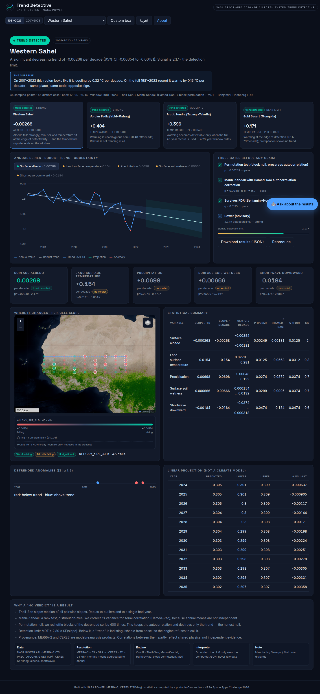
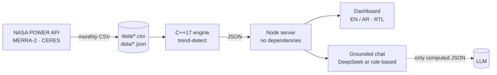

# Trend Detective

**Finds real trends. Refuses fake ones.**

An Earth-system trend dashboard built for the **NASA Space Apps Challenge 2026** challenge
*"Be An Earth System Trend Detective!"*. It selects Earth-science variables, visualises them over a
region and a long period, estimates the rate of change — and then decides whether that change is
**detectable at all** before it is allowed to make a claim.



## Why this is different

Most dashboards will happily draw a line through noise and print a p-value. NASA's own challenge text
warns that a variable "can trend one way in one region and the opposite way in another", and that a
trend may be insignificant or need a longer record. We took that as the specification:

- **Three gates, all mandatory.** A trend is only reported if the block-permutation test, the
  autocorrelation-corrected Mann–Kendall test, *and* the minimum-detectable-trend test all pass.
  Otherwise the dashboard says **NO VERDICT** and shows you the detection limit next to the estimate.
- **"Where" is answered.** A per-cell slope field, not one box average — and we publish how many
  sampled points collapse onto distinct model cells (16 points → 12 cells in Jordan).
- **The detector is calibrated.** `--selftest` prints the false-positive rate and the detection curve
  on synthetic series. A tool that finds trends should be able to prove it doesn't find them in noise.
- **Grounded interpretation.** The chat model only ever receives the computed JSON, never raw data.

## What it found (real data, 1981–2023 for MERRA-2 vars; 2001–2023 for CERES)

| Region | Headline | Verdict | Confidence |
|---|---|---|---|
| Western Sahel | surface albedo **−0.0027 per decade** (−0.27 percentage points) | TREND | strong (2.2× limit) |
| Jordan Badia | temperature **+0.48 °C per decade** | TREND | strong (3.2×) |
| Arctic tundra | temperature **+0.40 °C per decade** | TREND | moderate (1.3×) |
| Gobi Desert | temperature **+0.17 °C per decade** | TREND | near the limit (0.9×) |

And the cases where the answer is **no**:

| Region | Variable | p (Hamed–Rao) | Verdict |
|---|---|---|---|
| Sahel | temperature (full record) | 0.056 | **NO VERDICT** |
| Sahel | precipitation (full record) | 0.087 | **NO VERDICT** |
| Jordan | precipitation | 0.205 | **NO VERDICT** |
| Gobi | albedo | 0.221 | **NO VERDICT** |

### The window changes the answer — and we show it

Same region, same code, two windows:

| Sahel, temperature | 1981–2023 | 2001–2023 |
|---|---|---|
| slope | **+0.15 °C/dec** | **−0.32 °C/dec** |
| verdict | NO VERDICT (p = 0.056) | TREND (p = 0.014, q = 0.003) |

A 23-year window says "cooling"; the full 43-year record says "warming, not yet significant".
The dashboard has a window switch so anyone can see this for themselves — which is precisely the
lesson in the challenge text ("sometimes all a trend needs is a longer period").

### Multiplicity is controlled

With five variables and up to 45 cells, raw p-values over-claim. Every claim therefore passes
**Benjamini–Hochberg FDR**: the Sahel albedo map goes from 28 cells with p < 0.05 to **14 cells with
q < 0.05**. Both numbers are shown so the correction is visible, not hidden.

## Data

NASA **POWER** API (`power.larc.nasa.gov`) — no account required.

| Key | Variable | Product | Native grid |
|---|---|---|---|
| `TS` | Earth skin temperature | MERRA-2 | 0.5° × 0.625° |
| `PRECTOTCORR` | Precipitation (corrected) | MERRA-2 | 0.5° × 0.625° |
| `GWETTOP` | Surface soil wetness | MERRA-2 | 0.5° × 0.625° |
| `ALLSKY_SRF_ALB` | Surface albedo | CERES SYN1deg | 1° × 1° |
| `ALLSKY_SFC_SW_DWN` | Shortwave downward | CERES SYN1deg | 1° × 1° |

Preset regions: **Western Sahel** (45 points), **Jordan Badia** (16 points → 12 cells), **Arctic tundra**
(9 points) and **Gobi Desert** (9 points). Each has a full-record and a 2001–2023 view. A custom bounding box (≥ 2°) fetches the centre point live from POWER.

> Because MERRA-2 and CERES are reanalysis/retrieval products, correlations between them partly
> reflect shared physics rather than independent evidence. This is stated in the UI.

## Method

- **Theil–Sen slope** — median of all pairwise slopes; robust to outliers.
- **Mann–Kendall** — rank-based, distribution-free, tie-corrected.
- **Hamed–Rao** — variance inflation using the effective sample size, because annual means are
  serially correlated (this is what makes naive p-values dishonest).
- **Block permutation null** — 400 reshuffles of blocks of the detrended series: keeps the
  autocorrelation, destroys only the trend.
- **Minimum detectable trend** — MDT = 2.80 × SE(slope); the claim must exceed it.
- **Benjamini–Hochberg FDR** — controls false discoveries across the variable family and across cells.
- **Two windows** — 1981–2023 (MERRA-2) vs 2001–2023, switchable in the UI.
- **Anomalies** — z-scores of the detrended series.
- **Projection** — linear extrapolation with widening uncertainty; explicitly *not* a climate model.

Full details and the calibration table: [`docs/methodology.md`](docs/methodology.md).

## Architecture



## Live

**Source: https://github.com/saleem-mr/trend-detective**

**https://trend.mawqi3k.com/** · host: Hostinger Large (Frankfurt) · nginx with Let's Encrypt TLS (HTTP/2, HSTS)

## Run locally

```bash
# 1. build the statistics engine
npm run engine        # g++ -O3 -std=c++17 engine/trend_detect.cpp -o engine/trend-detect
./engine/trend-detect --selftest

# 2. build the preset results
./scripts/build_presets.sh

# 3. serve
node server.js        # http://localhost:3000
```

No `npm install` is required: there are no runtime dependencies.

## Test

```bash
npm test              # engine calibration + schema checks + endpoint smoke test
```

## Deploy with Docker

```bash
cp .env.example .env  # optional keys
docker compose up --build   # app on :3000 behind nginx on :80/:443
```

## Swap in another ML engine

The server never hardcodes the binary path. Set `ML_ENGINE_PATH` to any executable that accepts the
documented contract (`lib/engine-adapter.js`):

```
trend-detect --data DIR --region NAME --bbox a,b,c,d --primary KEY \
             --grid-param PARAM --predict-until 2035 --out FILE
```

The engine's input is just a directory of `date,value`-style CSVs, so a MODIS/Earthdata pipeline can be
dropped in without touching the app.

## Map

A real Leaflet map, **vendored locally** (`web/vendor/leaflet`, BSD-2) so nothing is fetched from a CDN:

| layer | source | role |
|---|---|---|
| Basemap | **NASA GIBS** `BlueMarble_ShadedRelief_Bathymetry` (2004-08-01) | geographic context, dimmed to match the dark theme |
| **NASA NDVI** | NASA GIBS WMTS `MODIS_Terra_NDVI_8Day`, 2025-07-01 | context only — **not** used in any statistic |
| Trend cells | this project's engine | one circle per sampled POWER cell: colour = slope sign, ring = significant |
| Region box | this project | the analysed bounding box |
| Legend · scale · layer switcher | this project | slope range, distance, toggles |

Clicking a cell opens a popup with that cell's own 23-year series, its slope, permutation p and
significance. The layer switched (top-right) toggles the NDVI overlay and the cells. If the basemap
cannot be reached the panel shows an *offline* badge and the vector layers keep working — the demo does
not depend on the tiles.

> The NDVI layer is a **recent** satellite composite shown for geographic context; the statistics come
> only from the POWER time series.

**No map API key is required.** Both the basemap and the NDVI overlay come from NASA GIBS, which is
open and key-free; Leaflet itself is vendored. The only third-party dependency in the whole app is the
optional LLM provider.

## Chat providers

The interpreter is provider-agnostic and speaks the OpenAI chat-completions shape.

| order | provider | key | model (default) | note |
|---|---|---|---|---|
| 1 | TokenHarbor | `TOKENHARBOR_API_KEY` | `deepseek-v4.1-flash:free` | one key, many models, ~1–3 s |
| 2 | DeepSeek | `DEEPSEEK_API_KEY` | `deepseek-chat` | official API |
| 3 | llm7.io | **none** | `DeepSeek-V4-Flash-0731` | keyless, rate-limited (quota window) |
| 4 | Groq | `GROQ_API_KEY` | `llama-3.3-70b-versatile` | lowest latency |
| — | rule-based | none | — | deterministic template, always available |

Set `LLM_PROVIDER`, `LLM_MODEL`, `LLM_BASE_URL`, `LLM_API_KEY` to point at any other
OpenAI-compatible endpoint. The chain falls through automatically on error or quota,
and `/api/health` reports the active order.

> A key pasted into a chat or a ticket should be rotated afterwards. `.env` is gitignored and
> never printed by the server.


## Use of Super Intelligence (SI)

Disclosed as required by the NASA Space Apps SI rules (generated code must be acknowledged in descriptive
text and metadata).

**Team ownership.** The challenge selection; the concept of a detector that reports a trend only when the
data can support it; the standard every method had to meet (significance *and* a published detection
limit); the region and variable selection; and all validation decisions — including two corrections we made
to our own published numbers — are the team's.

**Implementation.** AI coding assistants were used as tooling to write and refactor substantial parts of
the C++ engine, the Node server and the front end under the team's direction. Every result was reviewed,
tested and corrected by the team (`npm test`, `./engine/trend-detect --selftest`).

**In the product.** The optional chat panel uses a large language model strictly grounded on the
pre-computed results JSON — it never receives raw data — and falls back to a deterministic interpreter when
no key is configured (verified in English and Arabic).

**Not SI-generated.** No generated imagery or video is used: screenshots are captures of the running
application and the demo deck is produced from our results by `docs/slides/build_deck.py`. No NASA branding
or mission identifiers are used.

## License

MIT — see [LICENSE](LICENSE). Third-party notices (Leaflet BSD-2, NASA data attribution, OFL fonts) are in
[NOTICE.md](NOTICE.md).

## Team

**The Orcas** · Irbid, Jordan · NASA Space Apps Challenge 2026.
Data: NASA POWER. This project is not affiliated with or endorsed by NASA.
